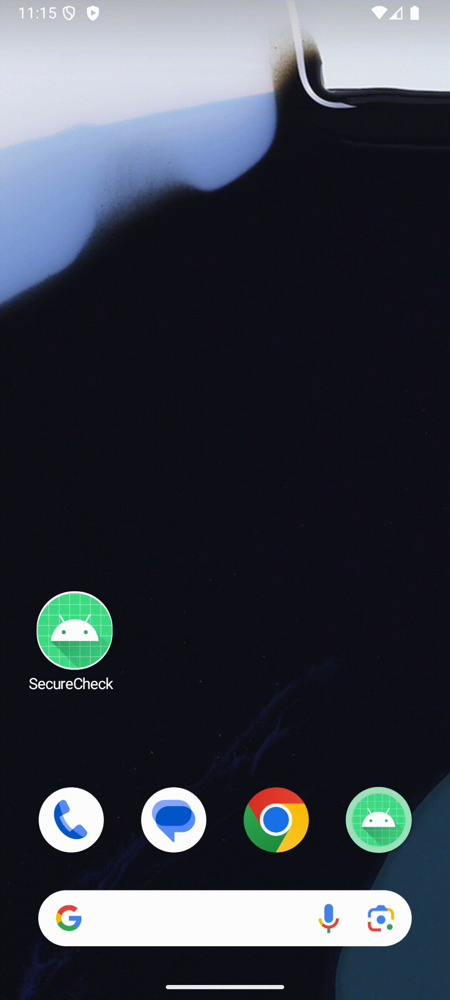
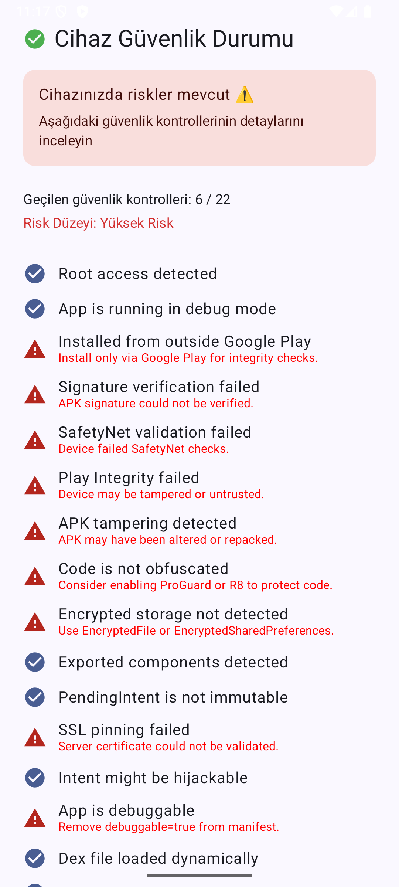

# SecureCheck

[](LICENSE)
[](https://github.com/muhammedalikcb/securecheck/actions/workflows/ci.yml)


[](https://github.com/muhammedalikcb/securecheck/stargazers)

SecureCheck is an open source Android app that runs 23 device and app integrity checks at launch and shows the result on one screen. Root, debugger, Frida, Xposed, emulator, tampering, Play Integrity, SSL pinning, WebView settings and more.

I built it to show how these checks look in a real project structure (MVVM, Clean Architecture, Dagger 2), not as one big utility class. Every check is its own detector and use case, so you can read, test or copy them one by one.

[Türkçe açıklama aşağıda.](#türkçe)

## Contents

* [Checks](#checks)
* [Screenshots](#screenshots)
* [Download](#download)
* [Build and run](#build-and-run)
* [Architecture](#architecture)
* [Exported report](#exported-report)
* [Testing and debugging](#testing-and-debugging)
* [Ideas for later](#ideas-for-later)
* [Contributing](#contributing)
* [License](#license)

## Checks

| Check | What it looks at |
| --- | --- |
| Root | Known su paths and root apps, `which su`, test-keys builds, `ro.debuggable` and `ro.secure` |
| Debugger | Whether a debugger is attached |
| Installer | Whether the app was installed from Google Play |
| APK signature | Compares the signing certificate's SHA-256 with an expected hash that is stored encrypted (AES key in Android Keystore) |
| Tampering | Package name and signature mismatch, plus generic or SDK build fingerprints |
| Play Integrity | Requests a Play Integrity token. Real verdict checks need a backend, which this demo doesn't have |
| Obfuscation | Whether R8/ProGuard was applied |
| Encrypted storage | Whether EncryptedSharedPreferences and EncryptedFile work |
| Exported components | Exported activities, services, receivers and providers |
| PendingIntent | Mutable PendingIntents (`FLAG_MUTABLE`) |
| SSL pinning | Connects with a trust manager that only accepts the bundled certificate |
| Intent hijacking | Intents that other apps could also resolve |
| Debuggable build | `android:debuggable=true` |
| Dynamic dex | Dex files loaded at runtime |
| Reflection | Reflection-style methods (`invoke`, `access$`, `reflect`) in app classes |
| Frida | frida-server and gadget files, port 27042, Frida in the process memory map |
| Xposed | Xposed framework classes on the classpath |
| WebView | JavaScript enabled, file access allowed, insecure JS interfaces (3 checks) |
| Emulator, VPN, mock location | Counted in the risk level, not shown as separate rows |

All results go into a single `SecurityState`, which drives the UI, the risk level and the JSON export.

## Screenshots

<table>
  <tr>
    <th>MotionLayout transition</th>
    <th>Scan result</th>
  </tr>
  <tr>
    <td align="center"></td>
    <td align="center"></td>
  </tr>
</table>

## Download

Grab the signed APK from the [latest release](https://github.com/muhammedalikcb/securecheck/releases/latest) if you just want to see the checks on your own device.

## Build and run

```bash
git clone https://github.com/muhammedalikcb/securecheck.git
cd securecheck
./gradlew clean assembleDebug
```

The checks start as soon as `MainActivity` opens. Keep in mind that a debug build fails some checks on purpose (debuggable, obfuscation, installer, signature).

## Architecture

MVVM and Clean Architecture, with Dagger 2 for dependency injection.

```
UI (Compose) -> ViewModel -> CompositeCheckSecurityUseCase -> use cases -> detectors -> SecurityState
```

```
core/
  reverseanalysis/   Frida, Xposed, emulator
  crypto/            SecureCipher (AES with Android Keystore)
  network/           SSL pinning, VPN
  icc/               exported components, intent hijacking, PendingIntent
  webview/           WebView settings
  location/          mock location
  obfuscation/, reflection/, tamper/
data/
  detector/          root, debugger, installer, integrity, signature, tamper
  local/secure/      encrypted storage
  log/               JSON export
domain/
  usecase/           one use case per check, plus the composite one
  model/             SecurityState, AppIntegritySnapshot
  extension/         risk level and passed check count
presentation/
  screen/security/   Compose screen, MotionLayout, ViewModel
di/                  Dagger component and modules
```

Data flows one way, from the detectors up to the UI. Layers only talk to the one below them, and every detector sits behind an interface so it can be faked in tests and previews.

## Exported report

The "Export report" button writes the full state to `files/security_log.json` in the app's private storage. A shortened example:

```json
{
  "isRooted": false,
  "isDebuggerAttached": false,
  "isFromPlayStore": true,
  "isSignatureValid": true,
  "isGenuine": true,
  "isTampered": false,
  "isSslPinningPassed": true,
  "webView": {
    "isJsEnabled": false,
    "isFileAccessAllowed": false,
    "hasInsecureJsInterface": false
  },
  "isFridaDetected": false,
  "riskLevel": "Safe",
  "overallSafe": true,
  "timestamp": 1715523375000
}
```

## Testing and debugging

* `FakeStateFactory` builds safe and risky states for Compose previews (for example `PreviewSecurityStatusScreenSafe`).
* `SecurityLogExporter` writes the JSON report.
* `SecureStorageManager` exercises EncryptedSharedPreferences and EncryptedFile.
* SSL pinning uses `res/raw/securecheck_cert.cer`, a self-signed certificate for `securecheck.local`. To see the check pass, point `securecheck.local` at a local HTTPS server that uses the matching key, or replace the file with your own server's certificate.

## Ideas for later

Not built yet, but on my list:

| Idea | Approach |
| --- | --- |
| SELinux mode | Read `getenforce` and flag Permissive |
| Open ports | Look for unexpected listening ports |
| Sandbox escapes | `run-as`, world-readable files, shared UIDs |
| Native anti-debugging | `ptrace` and signal based checks in C++ |
| Hidden root | MagiskHide, Zygisk and similar cloaking |
| MITM proxies | User-installed CAs, proxy settings, Burp certificates |

## Contributing

Pull requests are welcome. New detectors, better heuristics for the existing ones and Compose UI tests would all help. If you're adding a check, follow the existing pattern: a detector behind an interface, a use case, a field in `SecurityState` and strings in both languages.

## License

MIT. See [LICENSE](LICENSE).

Made by [Muhammed Ali Kocabey](https://github.com/muhammedalikcb) · [muhammedalikocabey.com](https://muhammedalikocabey.com) · [Shaping the Future of Android (podcast)](https://open.spotify.com/show/7waAQAWmr2WIQNTlTJkkos) · [Medium](https://medium.com/@muhammedalikocabey)

---

## Türkçe

SecureCheck, uygulama açılırken 23 cihaz ve uygulama bütünlüğü kontrolü çalıştırıp sonucu tek ekranda gösteren açık kaynak bir Android uygulaması. Root, debugger, Frida, Xposed, emülatör, APK değişikliği, Play Integrity, SSL pinning, WebView ayarları ve daha fazlası.

Bu kontrollerin gerçek bir proje yapısında (MVVM, Clean Architecture, Dagger 2) nasıl durduğunu göstermek için yazdım. Her kontrol ayrı bir detector ve use case, yani tek tek okuyabilir, test edebilir ya da kendi projene alabilirsin.

### Kontroller

* Root, debugger, emülatör, Frida ve Xposed tespiti
* Play Integrity token isteği (gerçek doğrulama için backend gerekir, bu demoda yok)
* APK imzası (SHA-256, beklenen hash Android Keystore'daki AES anahtarıyla şifreli tutulur) ve R8/ProGuard kontrolü
* APK üzerinde değişiklik, debuggable build ve dinamik dex yükleme tespiti
* Exported component, intent kaçırma ve mutable PendingIntent kontrolleri
* Gömülü sertifikayla SSL pinning
* WebView'da JavaScript, dosya erişimi ve güvensiz JS interface kontrolleri
* VPN ve sahte konum tespiti (risk seviyesine dahil)

Tüm sonuçlar tek bir `SecurityState` içinde toplanıyor. Arayüz, risk seviyesi ve JSON raporu buradan besleniyor.

### İndirme

Sadece kendi cihazında denemek istiyorsan imzalı APK'yı [son sürümden](https://github.com/muhammedalikcb/securecheck/releases/latest) indirebilirsin.

### Kurulum

```bash
git clone https://github.com/muhammedalikcb/securecheck.git
cd securecheck
./gradlew clean assembleDebug
```

Kontroller `MainActivity` açılınca başlıyor. Debug build'de bazı kontrollerin (debuggable, obfuscation, kaynak, imza) bilerek başarısız olduğunu unutma.

### Mimari

* `core/`: Düşük seviyeli dedektörler (Frida, Xposed, emülatör, SSL pinning, VPN, WebView)
* `data/`: Root, debugger, imza, Play Integrity gibi dedektörler, şifreli depolama ve JSON export
* `domain/`: Her kontrol için bir use case, `SecurityState` ve risk hesabı
* `presentation/`: Compose ekranı, MotionLayout ve ViewModel
* `di/`: Dagger component ve modülleri

### Rapor

"Raporu Dışa Aktar" butonu tüm durumu uygulamanın özel dizinine, `files/security_log.json` dosyasına yazar. Örnek format yukarıdaki İngilizce bölümde.

### Test ve debug

* `FakeStateFactory` Compose önizlemeleri için güvenli ve riskli durumlar üretir.
* `SecureStorageManager` EncryptedSharedPreferences ve EncryptedFile'ı dener.
* SSL pinning için `res/raw/securecheck_cert.cer` kullanılıyor (`securecheck.local` için self-signed). Kontrolün geçtiğini görmek için `securecheck.local` adresini aynı anahtarı kullanan yerel bir HTTPS sunucusuna yönlendir ya da dosyayı kendi sunucunun sertifikasıyla değiştir.

### Sonra eklemek istediklerim

SELinux modu, açık port taraması, sandbox kaçışları (`run-as`, herkesin okuyabildiği dosyalar), native anti-debug (`ptrace`), gizlenmiş root (MagiskHide, Zygisk) ve MITM proxy tespiti.

### Katkı

PR'lara açığım. Yeni dedektörler, mevcut kontrollerin iyileştirilmesi ya da Compose UI testleri çok işe yarar. Yeni bir kontrol eklerken mevcut düzeni takip etmen yeterli: interface arkasında bir dedektör, bir use case, `SecurityState` içinde bir alan ve iki dilde string.

### Lisans

MIT. Ayrıntılar [LICENSE](LICENSE) dosyasında.
