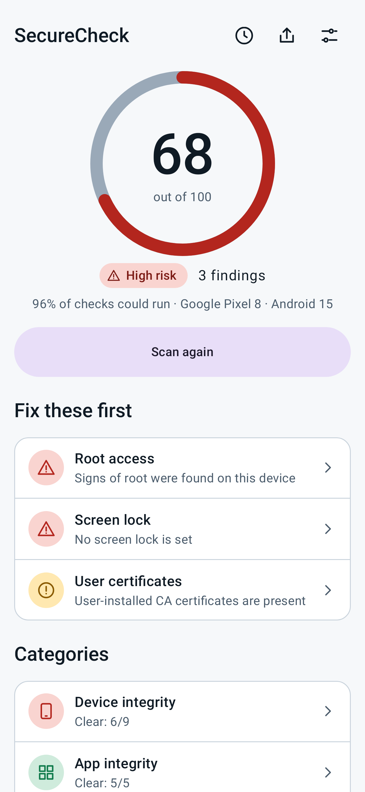
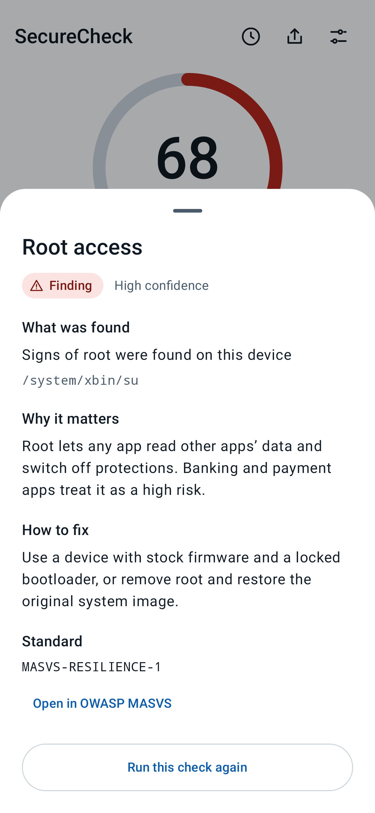
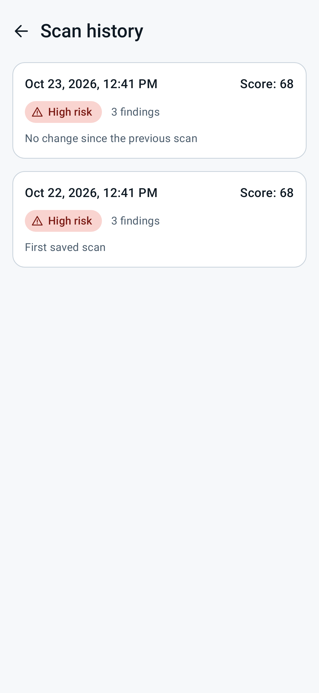
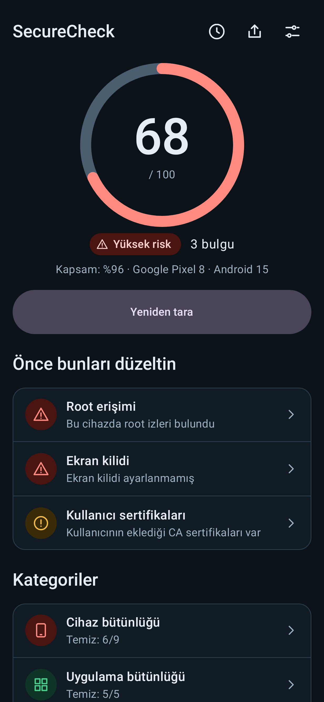
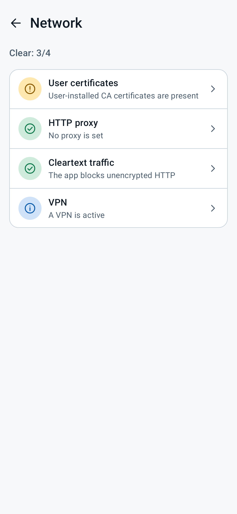
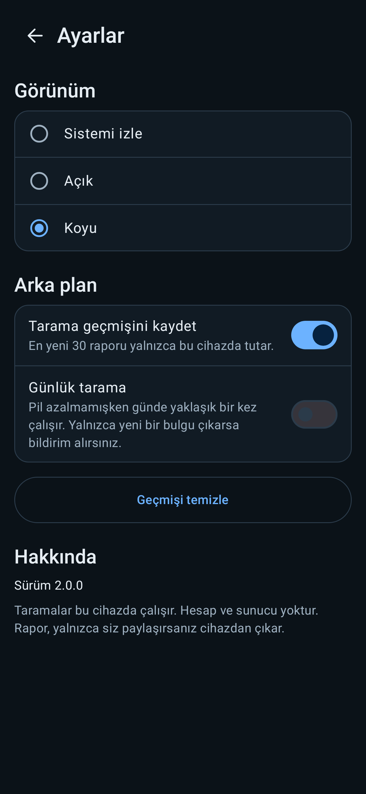
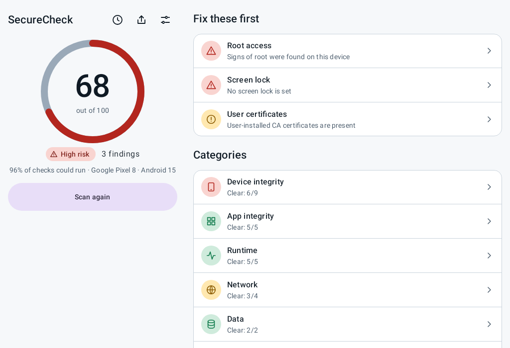

# SecureCheck

[](https://github.com/muhammedalikcb/securecheck/actions/workflows/ci.yml)
[](https://github.com/muhammedalikcb/securecheck/actions/workflows/codeql.yml)
[](LICENSE)


SecureCheck inspects the Android device it runs on and the app itself, and turns 27 checks into one score, a short
list of what to fix first, and a report you can share. Everything runs on the device. There is no account and no
server.

It is also a reference for how these checks look in a real project: each one is a small class behind an interface,
with a test for the finding and the clean case, mapped to an OWASP MASVS control.

[Türkçe özet aşağıda.](#türkçe)

<table>
  <tr>
    <td align="center"></td>
    <td align="center"></td>
    <td align="center"></td>
  </tr>
  <tr>
    <td align="center"></td>
    <td align="center"></td>
    <td align="center"></td>
  </tr>
</table>

<p align="center"></p>

<sub>Screenshots are rendered by the Robolectric UI tests, not captured on a physical device.</sub>

## What it does

* **Score and risk.** One number from 0 to 100 and a label (Low, Moderate, High, Critical), with the findings that
  cost the most listed first.
* **Evidence.** Every result shows what was found, how sure the check is, and how to fix it.
* **History.** The newest 30 scans stay on the device, and the dashboard shows what changed since the last one.
* **Daily scan (optional).** Runs about once a day while the battery is not low, and notifies only when a new
  finding appears. Off by default.
* **Share.** Export a scan as JSON or as a single self-contained HTML page. A report leaves the device only when
  you share it.
* **Accessible by design.** Status is never color alone, touch targets are at least 48 dp, large font sizes and
  reduced motion are respected, light and dark themes are contrast-tested.
* **Adapts to wide screens.** From 840 dp the score stays pinned on the left while findings scroll on the right.
* **English and Turkish**, switchable per app on Android 13 and later.

## Checks

| Category | Check | MASVS v2 control |
| --- | --- | --- |
| Device | Root access, Hardware key attestation, Play Integrity, Developer options*, USB debugging*, Emulator | RESILIENCE-1 |
| Device | Screen lock | CRYPTO-2 |
| Device | Biometric lock | AUTH-2 |
| Device | Security patch level* | CODE-1 |
| App | App signature, Install source* | RESILIENCE-2 |
| App | Debuggable build | RESILIENCE-4 |
| App | Code shrinking | RESILIENCE-3 |
| App | Target SDK | CODE-1 |
| Runtime | Magisk | RESILIENCE-1 |
| Runtime | Injected code | RESILIENCE-2 |
| Runtime | Debugger, Frida instrumentation, Xposed and LSPosed | RESILIENCE-4 |
| Network | VPN, HTTP proxy, User certificates, Cleartext traffic | NETWORK-1 |
| Data | Hardware-backed keystore | CRYPTO-2 |
| Data | App backup | STORAGE-2 |
| Platform | Exported components | PLATFORM-1 |
| Platform | Accessibility services | PLATFORM-3 |

The mapping follows the OWASP MASTG and MASWE weakness catalogue (for example MASWE-0017 for screen lock, MASWE-0054
for device attestation, MASWE-0065 for instrumentation tools). Rows marked * have no weakness entry of their own, so
the control shown is the nearest one. A check informs a control; it does not prove the app meets it.

A check has one of five outcomes: passed, finding, informational, expected (for example "debuggable" on a debug
build), or not run (with the reason). A check that could not run is never reported as passed.

### How the score works

```
score = 100 − Σ (severity weight × confidence factor)      over findings
```

| Severity | Weight | | Confidence | Factor |
| --- | --- | --- | --- | --- |
| Critical | 25 | | High | 1.0 |
| High | 15 | | Medium | 0.6 |
| Medium | 8 | | Low | 0.3 |
| Low | 3 | | | |
| Info | 0 | | | |

* A confirmed (high confidence) high or critical finding caps the score at 69, so a rooted device cannot read as
  good because everything else passed.
* Labels: 90 and above is Low risk, 70 to 89 Moderate, 40 to 69 High, below 40 Critical.
* Checks that could not run lower the **coverage** figure ("96% of checks could run") instead of improving the score.

## Limits you should know about

These are the reasons the app calls its results signals, not verdicts.

* **Client-side checks can be bypassed.** A device an attacker controls can hide from any check that runs on it.
  Root hiders and renamed Frida builds exist. Treat a clean result as "nothing obvious", not "safe".
* **Play Integrity and key attestation need a server.** The app can request a token and read a hardware key
  certificate, but only a backend can verify them. The app says so instead of claiming a verdict. See
  [docs/play-integrity-backend.md](docs/play-integrity-backend.md). No backend is included.
* **History is not encrypted.** Reports sit in the app's private storage, are excluded from backups and device
  transfers, and are readable only on a rooted device. If your threat model includes that, turn history off.
* **Exports contain the device model and technical evidence** (paths, package names). Review before sharing publicly.
* **Verified with JVM and Robolectric tests**, not an instrumented run on every device and ROM. Heuristics vary by
  manufacturer, so please report false results with the issue template.

## Privacy

No analytics, no crash reporting, no network calls, no accounts. The only permission requested at runtime is
notifications, and only when you turn on the daily scan; the scan still runs if you decline. Reports are written to
private app storage and leave it only through the Android share sheet when you choose to share.

## Build

JDK 17 and the Android SDK. Static analysis is [detekt](config/detekt/detekt.yml) and ktlint (via Spotless).

```bash
git clone https://github.com/muhammedalikcb/securecheck.git
cd securecheck
./gradlew assembleDebug
```

A debug build reports some checks differently on purpose (debuggable, code shrinking, install source, signature).

```bash
./gradlew spotlessCheck detekt lintDebug testDebugUnitTest assembleRelease   # what CI runs
```

Release signing is read from Gradle properties or environment variables (`RELEASE_STORE_FILE`,
`RELEASE_STORE_PASSWORD`, `RELEASE_KEY_ALIAS`, `RELEASE_KEY_PASSWORD`); without them a release build falls back to
the debug key so the project still builds for everyone. To enable the Play Integrity request, set
`SECURECHECK_INTEGRITY_PROJECT_NUMBER`.

## Architecture

MVVM and Clean Architecture, Dagger 2 with KSP, Jetpack Compose, Kotlin coroutines and Flow.

```
presentation/   Compose screens, design system, ViewModels
domain/         models, ScanEngine, ScoreCalculator, history and settings contracts (no Android types)
data/           one class per check, report storage, export, WorkManager, notifications
di/             Dagger component and modules
```

`ScanEngine` runs the registered checks concurrently and emits progress events. A check that throws becomes "not run",
never "passed". The domain layer has no Android dependencies, so the score, the diff between scans and the
background-scan rules are plain JVM tests.

Every exported report carries a `schemaVersion` and stable check keys, so reports from older versions stay readable.

## Supply chain

The workflows under `.github/workflows` are **manual only**: nothing runs on push, pull request or a schedule, so no
CI minutes are spent until a maintainer starts one from the Actions tab.

| Workflow | What it does |
| --- | --- |
| CI | formatting, static analysis, lint (warnings are errors), unit tests with coverage, debug and release builds |
| CodeQL | code scanning for Kotlin |
| Supply chain | Trivy scan of dependencies, secrets and configuration, plus a CycloneDX SBOM |
| Release | builds a signed APK from repository secrets and creates a **draft** release with SHA-256 sums |

Everything CI does can be run locally with the commands in [Build](#build). Dependabot proposes dependency updates
monthly.

## Contributing

See [CONTRIBUTING.md](CONTRIBUTING.md). Security problems: [SECURITY.md](SECURITY.md).

## License

MIT. See [LICENSE](LICENSE).

Made by [Muhammed Ali Kocabey](https://github.com/muhammedalikcb) · [muhammedalikocabey.com](https://muhammedalikocabey.com) · [Medium](https://medium.com/@muhammedalikocabey)

---

## Türkçe

SecureCheck, çalıştığı Android cihazı ve uygulamanın kendisini inceler; 27 kontrolü tek bir skora, önce
düzeltilecekler listesine ve paylaşılabilir bir rapora dönüştürür. Her şey cihazda çalışır: hesap yok, sunucu yok.

* 0–100 skor ve risk etiketi (Düşük, Orta, Yüksek, Kritik); her sonuçta kanıt, güven düzeyi ve düzeltme yolu.
* Son 30 tarama cihazda saklanır, kontrol paneli bir önceki taramadan beri değişeni gösterir.
* İsteğe bağlı günlük tarama: yalnızca yeni bir bulgu çıkarsa bildirim verir. Varsayılan olarak kapalıdır.
* Raporu JSON veya tek dosyalık HTML olarak paylaşırsınız; rapor yalnızca siz paylaşırsanız cihazdan çıkar.
* Türkçe ve İngilizce, Android 13 ve üzerinde uygulama başına dil seçimi.

**Sınırlar:** Cihaz üzerinde çalışan kontroller, cihazı ele geçiren biri tarafından atlatılabilir; temiz sonuç
"bariz bir şey yok" demektir, "güvenli" demek değildir. Play Integrity ve anahtar doğrulaması yalnızca bir sunucuda
doğrulanabilir ([belge](docs/play-integrity-backend.md)). Geçmiş şifrelenmez; özel depolamada tutulur ve
yedeklere dahil edilmez.

Kurulum: `./gradlew assembleDebug`
